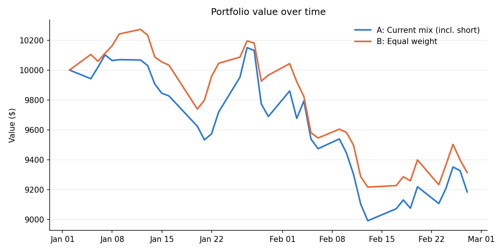
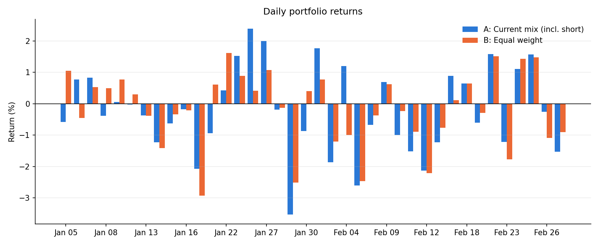
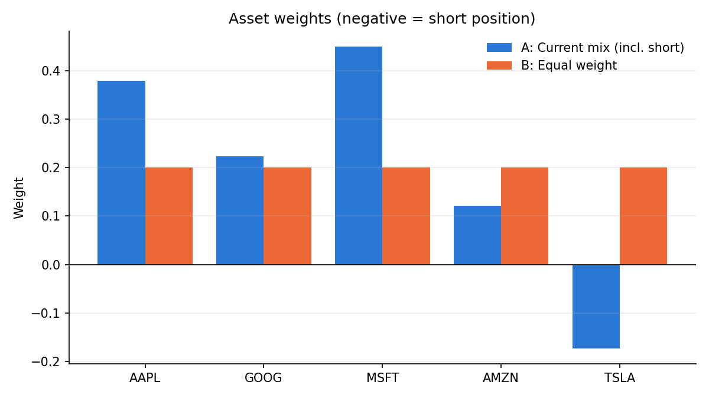

# PortfolioVec

**A vector-based portfolio value and return tracker.** Everything it computes comes from two operations in Chapter 1 of *Introduction to Applied Linear Algebra* (Boyd & Vandenberghe): vector addition and the inner product.

## Problem statement

Given a stock portfolio (including one **short position**), answer three questions:

| Question | Math | Book section |
|---|---|---|
| What is my portfolio worth? | `V = pᵀs` | 1.4 |
| What happens after I trade? | `s_new = s + b`, cash = `pᵀb` | 1.2, 1.4 |
| How much did I gain or lose each day, and which allocation is better? | `ρ_t = r_tᵀw` | 1.4 |

Where `s` = shares held (negative = short), `p` = prices, `b` = trade, `w = (p ⊙ s) / pᵀs` = weights (sum to 1), and `r_t` = daily asset returns.

**Assumption:** the value and trade demo holds **shares fixed**; the allocation comparison uses **constant weights**, i.e. the portfolio is re-balanced back to `w` every day.

## Architecture

```
config.yaml + data/raw/prices.csv
        |
        v
DATA      loader.py -> validator.py -> price matrix P (T x n)
        |
        v
CORE      vectors.py : value, trade, weights, leverage
          returns.py : return matrix R, portfolio return rho = R @ w
        |
        v
ANALYSIS  compare.py : allocation A vs B      metrics.py : summary stats
        |
        v
OUTPUT    report.py : console tables + CSV    plots.py : figures
```

The core modules are pure functions (arrays in, arrays out, no I/O), which is what the tests exercise.

## Install and run

```bash
python3 -m venv .venv
source .venv/bin/activate
pip install -r requirements.txt
python main.py        # runs the whole pipeline
pytest -q             # runs the tests
```

Price data is already in `data/raw/prices.csv`. To refresh it from Yahoo Finance: `python scripts/download_prices.py`.

### Dashboard

```bash
streamlit run app.py
```

An interactive dashboard at http://localhost:8501. It downloads **real daily closing prices live from Yahoo Finance** for whatever tickers and date range you choose (nothing is simulated). You can edit holdings, the trade and allocation B's weights in a table and see the value, trade check, charts and comparison update. If the download fails, it falls back to the real prices saved in `data/raw/prices.csv` and says so.

To try another scenario in the command-line pipeline, edit `config.yaml` (assets, holdings, trade, allocation weights); no code changes needed.

## Results

Data: daily closing prices for AAPL, GOOG, MSFT, AMZN, TSLA from 2026-01-02 to 2026-02-27 (39 trading days, 38 daily returns), from Yahoo Finance.

**Trade** (at the latest prices, short 30 TSLA):

| | Value |
|---|---|
| Portfolio value before | $69,509.09 |
| Portfolio value after | $71,002.85 |
| Net cash of trade `pᵀb` | $1,493.76 (= after − before) |

**Allocation comparison** ($10,000 start):

| Metric | A: current mix (incl. short) | B: equal weight |
|---|---|---|
| Avg daily return | −0.215% | −0.180% |
| Best day | +2.39% | +1.62% |
| Worst day | −3.53% | −2.93% |
| Final value | $9,183.11 | $9,312.95 |
| Total return | −8.17% | −6.87% |
| Leverage | 1.35 | 1.00 |
| Daily risk (std) | 1.353% | 1.169% |





### Conclusion

**B (equal weight) did better**: it lost 6.87% against 8.17% for A, with lower daily risk.

The short position was *not* the reason A lost. TSLA fell on 19 of 38 days, and the short (weight −0.174) **added about +1.31%** to A over the period. A lost more because shorting frees up cash that is put into the long positions (leverage 1.35), and 45% of A sits in MSFT, which fell the most over this period. B spreads the money evenly, so no single stock dominates.

## Limitations

1. Past returns do not guarantee future returns.
2. No transaction costs, taxes, or borrowing fees on the short position.
3. Daily re-balancing to constant weights is an idealization.
4. 38 daily returns is a small sample; the comparison is noisy.
5. Allocation A's weights are computed from holdings at the **latest** prices only, then applied to the whole period.

## Project layout

```
config.yaml            scenario: assets, holdings, trade, allocations
main.py                runs the pipeline
app.py                 Streamlit dashboard (live Yahoo Finance prices)
src/portfoliovec/      loader, validator, vectors, returns, compare, metrics, report, plots
scripts/               download_prices.py
tests/                 pytest unit tests
notebooks/demo.ipynb   step-by-step walkthrough
data/raw, processed    price CSVs
outputs/tables, figures
```

## License and author

Author: _your name here_. License: _choose one (e.g. MIT)_.
# PortfolioVec
